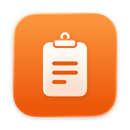
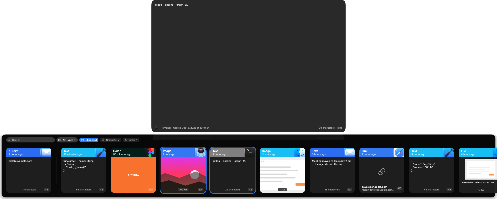

# myClips

A small clipboard manager for macOS 26, built for one person: me.



> [!NOTE]
> **Personal project.** myClips is a clean-room rebuild of the parts of [Paste](https://pasteapp.io) I actually use, with everything else left out. It is not affiliated with Paste or its makers and contains no code from it. The code is public in case it's useful to someone; I build it for my own Mac, so there are no releases, no roadmap and no support. **Pull requests are not accepted** — fork it and make it yours. Bug reports are welcome (see [CONTRIBUTING](CONTRIBUTING.md)).

## What it does

- **History with fast search.** Every copy is kept; type to search substrings, ignoring case and accents. Typical searches take under a millisecond across 100,000 clips.
- **A shelf at the bottom of the screen.** <kbd>✦</kbd><kbd>V</kbd> opens it over whatever you're doing (change the shortcut in Settings); <kbd>Return</kbd> pastes into the app you were in.
- **Pinned clips and pinboards.** Pin clips to the front of history, or keep collections that never expire.
- **Multi-select, preview, type filter.** Paste several clips at once (images included, where the target app takes rich text), preview anything large with Quick Look, filter to text, links, images or files.
- **Private by default.** Everything stays on your Mac in one SQLite file. No network access, no accounts, no telemetry. Password managers' concealed copies are never recorded.

### Not included, on purpose

iCloud sync, sharing, AI features, an MCP server, Spotlight indexing, snippets with variables, paste stacks, themes. If you need those, use Paste.

## Keyboard

✦ = Hyper (⌃⌥⇧⌘, for example Caps Lock with Karabiner).

| Key | Action |
| --- | --- |
| <kbd>✦</kbd><kbd>V</kbd> | Open or close the shelf (change it in Settings) |
| type | Search (resets every time the shelf opens) |
| <kbd>←</kbd> <kbd>→</kbd> | Move; with <kbd>⇧</kbd> extend the selection |
| <kbd>⌘</kbd>-click, <kbd>⇧</kbd>-click, <kbd>⌘</kbd><kbd>A</kbd> | Toggle, range, select all |
| <kbd>Return</kbd> or <kbd>⇧</kbd><kbd>Return</kbd> | Paste, or paste as plain text |
| <kbd>⌘</kbd><kbd>1</kbd>–<kbd>⌘</kbd><kbd>9</kbd>, double-click | Paste that clip |
| <kbd>⌘</kbd><kbd>C</kbd> | Copy the selection, keep the shelf open |
| <kbd>Space</kbd> (empty search) or <kbd>⌘</kbd><kbd>Y</kbd> | Large preview with exact copy time |
| <kbd>⌘</kbd><kbd>P</kbd> | Pin or unpin to the front of history |
| <kbd>⌘</kbd><kbd>K</kbd> or right-click | Actions: paste, preview, pin, add to pinboard, delete |
| <kbd>Tab</kbd> or <kbd>⇧</kbd><kbd>Tab</kbd> | Switch between history and pinboards |
| <kbd>⌘</kbd><kbd>N</kbd> | New pinboard |
| <kbd>⌘</kbd><kbd>⌫</kbd> | Delete the selection |
| <kbd>⌘</kbd><kbd>,</kbd> | Settings |
| <kbd>Esc</kbd> | Close the preview, then the shelf |

While the search field has text, the text-editing keys (<kbd>⌘</kbd><kbd>A</kbd>, <kbd>⌘</kbd><kbd>C</kbd> with text selected, <kbd>⌘</kbd><kbd>X</kbd>, <kbd>⌘</kbd><kbd>V</kbd>, <kbd>⌘</kbd><kbd>Z</kbd>, <kbd>⌘</kbd><kbd>⌫</kbd>, <kbd>⌥</kbd> and <kbd>⌘</kbd> with arrows) edit the text.

## Install (from source)

Needs macOS 26 and Xcode 26.

```sh
git clone https://github.com/sitek94/myclips && cd myclips
MYCLIPS_SIGN_IDENTITY="Apple Development" scripts/bundle.sh install
```

`bundle.sh` builds a release binary, wraps it as `myClips.app`, signs it and installs it to `~/Applications`. Sign with a stable identity (any *Apple Development* certificate from a free Apple account works) so macOS remembers the permissions below across rebuilds. Without one, use `MYCLIPS_SIGN_IDENTITY=-` for an ad-hoc signature and expect to re-grant permissions after every build.

### Permissions

- **Paste from Other Apps** (System Settings → Privacy & Security): set myClips to *Always Allow*, or macOS asks on every copy.
- **Accessibility**: lets myClips press `⌘V` for you. Without it, clips land on the clipboard and you paste yourself.

Both show in Settings (`⌘,`) with shortcuts to the right System Settings pane.

## Develop

```sh
scripts/check.sh                                   # format, lint, build, tests
xcrun swift run -c release MyClipsBench 100000     # search latency on synthetic data
```

Use `xcrun swift`, not a `swift` from elsewhere on your `PATH` — the package needs Xcode 26's toolchain.

- [docs/architecture.md](docs/architecture.md) — storage, search, capture, the shelf's focus model, pasting
- [docs/testing.md](docs/testing.md) — unit tests, benchmark, and the UI driver that tests the real app without touching your data
- [docs/gotchas.md](docs/gotchas.md) — traps around focus, the clipboard, permissions and building, with fixes
- [docs/decisions](docs/decisions) — why search, the shelf window and UI testing work the way they do
- The icon is an Icon Composer document: a gradient and our own glyph (`scripts/Glyph.swift`); `scripts/make-icon.sh` rebuilds it with [myKit](https://github.com/sitek94/mykit)'s `scripts/make-icon.swift`, and `bundle.sh` compiles it with `actool`.

## Versions

Changes are listed in [CHANGELOG.md](CHANGELOG.md); each version is a git tag (`v0.1.0`). Settings (`⌘,`) shows the installed version, build and commit.

## License

[MIT](LICENSE)
